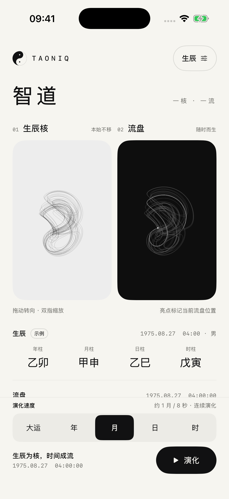
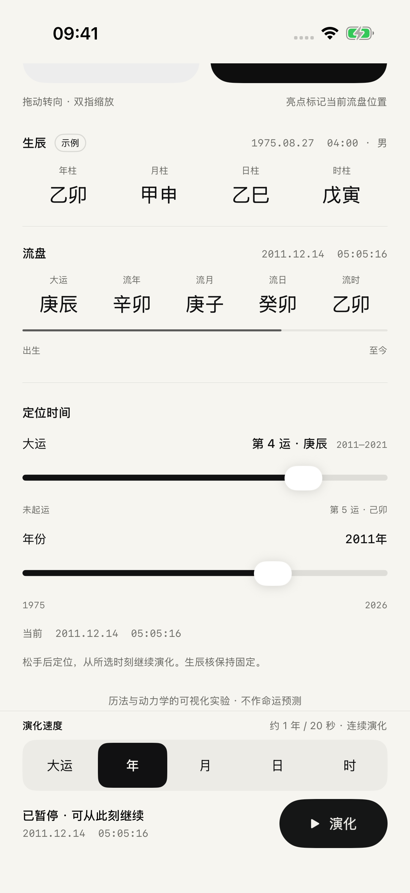

# TAONIQ · 智道

黑白太极风格的原生 iOS 演示。输入生辰，以固定生辰核与随时间演化的流盘并排观察。

 

## 在 Xcode 运行

1. 打开 `TAONIQ.xcodeproj`，选择 **TAONIQ** scheme。
2. 选择 iPhone 模拟器，按 **⌘R**。最低系统 iOS 18，无第三方 Swift 包、后端或账号要求。
3. 首次打开显示标记清楚的演示生辰。点右上角「生辰」，填写公历日期、时间与传统排运设定后生成。最近一次输入只保存在本机。
4. 单指拖动任一轨迹，两图同步改变视角；双指缩放，双击恢复视角。闲置时缓慢自动旋转。
5. 点「演化」开始，点暂停停在当前时刻，再点继续沿同一条路径推进。底部始终显示大运／年／月／日／时五档速度，可同时看图切换；默认「月」，计算较慢时自动放缓。
6. 右图亮点跟随真实流盘末点，亮线表示近期轨迹，淡线保留整体形态。自转只改变视角；快慢主要观察亮点与日期推进。
7. 向下滑，拖动「大运」选择真实起运、交运时点，或拖动「年份」选择某个公历年。拖动过程中预览目标，松手后定位，再点演化从那里连续播放；生辰核保持固定。

真机运行需在 Xcode 的 Signing & Capabilities 中选择你自己的开发团队。本仓库不包含证书、账号或个人签名配置；模拟器可以关闭代码签名构建。

v0.2.1 新增真实末点与近期轨迹高亮，速度选择固定在底部；本次 9 项针对性回归测试通过。五档实际推进速度已在正常旋转下逐档测量，记录见[验收记录](docs/验收记录.md)。

v0.2 已在 Xcode 26.3 / iPhone 17 Pro（iOS 26.3 模拟器）构建并运行，17 项数值、几何、播放状态与原生界面测试通过。尚未做真机续航或长期演化压力验证。

## 演化的含义

- 左图的出生参数、轨迹点固定，相机旋转只改变观看角度。
- 右图从出生或手动选定时刻的冻结种子末点持续积分，新样点进入、旧样点退出。没有将两幅静态图片做形状插值。
- 大运、年、月、日、时保持既有默认输入预算，随真实干支边界更新目标参数；内部参数平滑响应。每公历日固定对应 `8/7` 模型单位。
- 暂停不会丢失状态；晚到结果先缓冲，继续时才显示。更换生辰建立新会话。进入后台暂停演化；系统「减少动态效果」设置下不自动旋转，仍可手动查看。
- 切换速度沿当前会话继续，不改变同一日期的数值轨迹。拖动定位则建立选定时刻的新起点，不声称已经重建出生至该时刻的完整连续历史。年份定位到当年公历 1 月 1 日，出生年夹到出生时刻；实际流年干支仍按立春边界计算。
- 这是一套传统符号到人工动力系统的工程映射，不是命运预测。未知生辰沿用既有未校准预览；本演示不增加校准、命理解读或运势评分功能。

## 项目结构

| 路径 | 内容 |
| --- | --- |
| `TAONIQ/Views/` | SwiftUI 首页、生辰输入与黑白主题 |
| `TAONIQ/FlowStore.swift` | 输入、播放、暂停、后台与过时结果隔离 |
| `TAONIQ/EvolutionSpeed.swift` | 五档观看速度与日历长度计算 |
| `TAONIQ/Rendering/OrbitStage.swift` | SceneKit 三维轨迹、共同相机与拖拽 |
| `TAONIQ/Engine/` | JavaScriptCore 后台计算与原生数据桥 |
| `TAONIQ/Resources/` | 离线算法、历法依赖、哈希清单与许可 |
| `TAONIQTests/` / `TAONIQUITests/` | 数值与模拟器交互检查 |

算法来自 [TAONIQ v0.11](https://github.com/doyoulikelin-wq/TAONIQ/tree/80dc82ebb5503845fd3f0bd7fda8fb3351c6ac20)，公式、映射数据及连续积分源文件保持原样。详细口径见 [实现说明](docs/实现说明.md)，实际验收见 [验收记录](docs/验收记录.md)。

更新算法资源：`node scripts/sync-engine.cjs ../TAONIQ`。生成清单记录上游提交和源文件 SHA256；不要手改合并后的 `taoniq-engine.js`。

历法库 lunar-javascript 1.7.7 的 MIT 许可保存在 `TAONIQ/Resources/lunar-MIT-LICENSE.txt`。界面与太极图标由项目代码生成，不捆绑第三方字体或宗教画作。

## v0.2 时间控制

| 观看档位 | 目标节奏 |
| --- | --- |
| 大运 | 约 1 运（10 年）／100 秒 |
| 年 | 约 1 年／20 秒 |
| 月（默认） | 约 1 月／8 秒 |
| 日 | 1 日／4 秒 |
| 时 | 1 时辰（2 小时）／4 秒 |

年、月的时长按当前日期的实际日历长度计算，包含闰年和不同月长。五层输入同时保留；这些档位只决定观看节奏，不是关闭其他时间层。大运定位使用个人真实起运时刻及其后每十年边界，起运前单列「未起运」，未来时段不可选。
